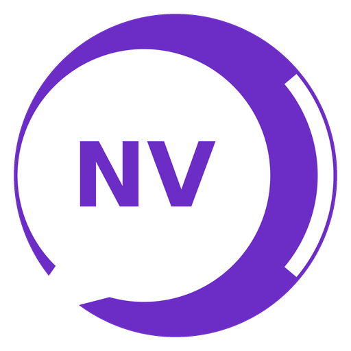

# Nvidiator Android

**An unofficial, experimental port of NVDA's sound and soul to Android.**

> **Experimental and unofficial.** Nvidiator is not made, endorsed or supported by NV Access, and it is not NVDA for Android. It is a hobby project that takes NVDA's own Python modules, sounds, wording and translations and runs them inside an Android screen reader. Expect rough edges. It has not been tested on a real phone yet. Read [Getting back to TalkBack](#getting-back-to-talkback) before you turn it on.

Nvidiator is an Android accessibility service (a screen reader, like TalkBack) written in Java. The parts that make NVDA sound like NVDA run as real NVDA Python code on the phone, through [Chaquopy](https://chaquo.com/chaquopy/):

- **NVDA's sounds and beeps**: the start and exit sounds, errors, browse and focus mode, the progress-bar and input-help tones.
- **NVDA's wording**: roles, states and messages come from NVDA's own `controlTypes` and `characterProcessing`, in NVDA's own translations (73 languages, compiled from NVDA's `nvda.po` files). Punctuation and symbol levels use NVDA's `symbols.dic`, and spelling uses NVDA's character descriptions.
- **NVDA's menus and screens**: the NVDA menu, the Exit dialog, Settings, the Speech viewer and the Python console use NVDA's exact text, translated by NVDA's translators. In German, for example, they read "Einstellungen…", "Beenden" and "Sprachausgabe-Betrachter". The only additions are a short gesture or key hint under menu items, notes where a setting works differently on Android, a tutorial and a quick reference.
- **NVDA's Python console**: NVDA's own console code, running on the phone. See [The Python console](#the-python-console).
- **NVDA's commands**: touch gestures follow NVDA's touch-screen commands, and a Bluetooth or USB keyboard gets NVDA's keyboard commands with Insert or Caps Lock as the NVDA key, plus single letter navigation.

Speech comes from any Android text-to-speech engine you have installed (the phone's default, or one you choose in Settings).

## Status

Version 0.1, a first experimental build.

**Built and checked on a computer:**

- The app compiles into APKs for 64-bit phones, 32-bit phones and x86_64 emulators, plus a universal APK. They pass Android's signature and zip-alignment checks.
- The Python side passes its desktop tests (`tests/`): 39 checks of the NVDA bridge (roles, states, messages, symbols and spelling in English, German and Urdu) and 9 checks of the Python console.

**Not tested on a phone yet:**

- Everything that only runs on Android: reading the screen, gestures, keyboard commands, NVDA's sounds through the speaker, the menus and settings screens, switching to and from TalkBack, and the 15-second safety switch-off.
- Chaquopy starting NVDA's Python on a real device.

**Known gaps:**

- Browse mode is simplified. Android has no virtual buffer like a web browser on Windows, so single letter navigation moves through what Android reports on screen.
- No braille, no add-ons, no NVDA synthesizers (eSpeak, OneCore). Speech uses Android's text-to-speech engines.
- Review cursor commands are limited to characters, words and lines of the current object.
- The APKs are signed with a debug key, so Play Protect may warn you.

Please report problems in [Issues](../../issues).

## Install

Nvidiator needs Android 7.0 or newer. Download the APK for your phone from the [latest release](../../releases):

| File | For |
|---|---|
| `nvidiator-android-0.1-arm64-v8a.apk` | Most phones from the last several years (64-bit) |
| `nvidiator-android-0.1-armeabi-v7a.apk` | Older 32-bit phones |
| `nvidiator-android-0.1-universal.apk` | Any phone or emulator, if you are not sure (bigger) |

Then:

1. Install it, by tapping the file or with `adb install nvidiator-android-0.1-arm64-v8a.apk`. Android may ask you to allow installs from unknown sources.
2. Open Nvidiator once and read the safety notes.
3. Optional but recommended: give it the permission to switch straight back to TalkBack (see below).
4. Make sure the accessibility shortcut (hold both volume keys) is set to TalkBack, in Settings, Accessibility.
5. Turn TalkBack off and Nvidiator on, in Settings, Accessibility, Installed apps (or Downloaded apps), Nvidiator. If TalkBack is on and the permission is granted, the app's "Switch from TalkBack to Nvidiator" button does this in one step.

## Getting back to TalkBack

There are three ways out, and the last two always work:

1. **The Exit menu.** Open the NVDA menu (swipe down then right, tap with three fingers, double tap with two fingers, or NVDA+N) and choose Exit, or press NVDA+Q twice. NVDA's Exit dialog offers **Exit to TalkBack**, which turns Nvidiator off and TalkBack on in one step. That needs a permission you grant once from a computer:

   ```
   adb shell pm grant com.irondonkey.nvidiator android.permission.WRITE_SECURE_SETTINGS
   ```

   Without it, Exit still turns Nvidiator off, and you turn TalkBack on with the shortcut below.
2. **The accessibility shortcut.** Hold both volume keys for about 3 seconds. Nvidiator never takes over the volume keys, so this always reaches Android. Set the shortcut to TalkBack before you try Nvidiator.
3. **The 15-second safety switch.** If no speech starts within 15 seconds of turning Nvidiator on, it plays NVDA's error sound and turns itself off, so touch works normally again.

From a computer you can also run `adb shell settings put secure enabled_accessibility_services com.google.android.marvin.talkback/com.google.android.marvin.talkback.TalkBackService` to put TalkBack back.

## Touch gestures

They follow NVDA's touch commands, with TalkBack's gestures for Android's own buttons.

| Gesture | Action |
|---|---|
| Slide one finger | Explore by touch |
| Double tap | Activate |
| Swipe right / left | Next / previous object (text mode: character) |
| Swipe up | Object containing it (text mode: previous line) |
| Swipe down | First object inside it (text mode: next line) |
| Three-finger swipe right / left | Next / previous word |
| Three-finger swipe up, or swipe right then left | Report focus |
| Three-finger swipe down, or swipe down then up | Say all |
| Two-finger tap | Stop speech |
| Swipe down then right, three-finger tap, or two-finger double tap | NVDA menu |
| Swipe up then down, or three-finger double tap | Switch object mode and text mode |
| Swipe left then right | Report the current object |
| Swipe left then down | Report title |
| Swipe right then up | Time (twice quickly: date) |
| Swipe up then right | Speech viewer |
| Swipe down then left | Back |
| Swipe up then left | Home |
| Swipe left then up | Recent apps |
| Swipe right then down | Notifications |
| Three-finger triple tap | Speech mode |
| Two-finger triple tap | Punctuation and symbol level |
| Four-finger tap | Input help |
| Four-finger double tap | Python console |
| Hold both volume keys | Accessibility shortcut (always works) |

## Keyboard commands

With a Bluetooth or USB keyboard. The NVDA key is Insert or Caps Lock (both can be changed in Settings); Numpad 0 also works when Insert is on.

| Keys | Action |
|---|---|
| NVDA+N | NVDA menu |
| NVDA+Q twice | Exit Nvidiator |
| NVDA+Down arrow or NVDA+A | Say all |
| NVDA+Up arrow or NVDA+L | Report the current object |
| NVDA+Tab | Report focus |
| NVDA+T | Report title |
| NVDA+B | Read the active window |
| NVDA+Enter, NVDA+Numpad star | Activate |
| NVDA+Space | Switch browse mode and focus mode |
| NVDA+S | Speech mode |
| NVDA+P | Punctuation and symbol level |
| NVDA+1 | Input help |
| NVDA+2 / NVDA+3 | Speak typed characters / words |
| NVDA+C | Spell the current object |
| NVDA+F12 | Time (twice quickly: date) |
| NVDA+F1 | Speech viewer |
| NVDA+Shift+B | Battery status |
| NVDA+Shift+arrows | Object navigation (next, previous, containing, first inside) |
| NVDA+Numpad 6, 4, 8, 2, 5 | Object navigation and current object |
| NVDA+Ctrl+arrows | Synth settings ring (rate, pitch, volume) |
| NVDA+Ctrl+G | NVDA Settings |
| NVDA+Ctrl+Z | Python console |
| Control | Stop speech |

**Single letter navigation** (add Shift to go back; off in edit fields and in focus mode): H heading, K link, B button, E edit field, F form field, X check box or switch, C combo box, R radio button, L list, I list item, G graphic, D landmark, T table.

## The Python console

NVDA's own `pythonConsole.py`, adapted to run on Android. Open it with a four-finger double tap, NVDA+Ctrl+Z, or the NVDA menu (Tools).

- Code you type or paste runs as real Python 3.11 on the phone. One line runs like NVDA's prompt (`>>>` and `...`); several pasted lines run together as one script.
- Tab completion, `help()`, `exit()` and NVDA's snapshot variables: `focus`, `nav`, `fg` and `caretObj` are the actual on-screen items.
- `speech`, `tones`, `ui` and `api` control the running screen reader, for example `speech.speakMessage("hello")`, `tones.beep(440, 100)` or `ui.message("hi")`. NVDA's modules such as `controlTypes` are there too, and `jclass` reaches Android's Java classes.
- Like NVDA's console, `_` holds the last result.

The console runs code with the screen reader's own permissions. Only paste code you trust.

## Building from source

You need JDK 17 or newer, the Android SDK (platform 36, build tools 36.x) and Python 3.11 on your PATH (Chaquopy uses it to compile the Python code; set `python.build` in `local.properties` if it is somewhere else).

```
./gradlew assembleDebug
```

The APKs land in `build/outputs/apk/debug/`. Desktop tests for the Python side: `python3.11 tests/test_bridge.py` and `python3.11 tests/test_console.py`.

NVDA's translations and dictionaries in `src/main/assets/nvda/locale` were made from NVDA's source with `tools/build_locale_data.py` (needs `pip install polib`). The NVDA Python modules in `src/main/python` come from NVDA's `source/` folder, with Windows-only parts replaced by Android code. The NVDA source used is [nvaccess/nvda](https://github.com/nvaccess/nvda) at commit `af55fb6b`.

## Why "Nvidiator"?

It is NVDA, trying its best to be a gladiator in an arena it was never built for.

## Credits and licence

- **NVDA** (NonVisual Desktop Access) is made by [NV Access Limited](https://www.nvaccess.org/) and contributors. Nvidiator uses NVDA's Python modules, sounds, wording and translations. NVDA's translations are the work of NVDA's volunteer translators.
- **Chaquopy** runs Python on Android.
- Built by Iron Donkey.

Nvidiator is free software under the **GNU General Public License version 2**, the same licence as NVDA. See [LICENSE](LICENSE). It comes with no warranty.

NVDA and NV Access are names of NV Access Limited. Nvidiator is not affiliated with, endorsed by or supported by NV Access. Please do not report Nvidiator problems to NV Access.
